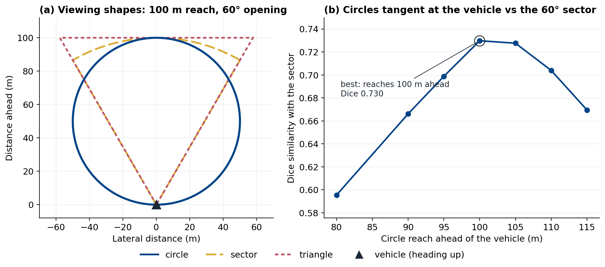
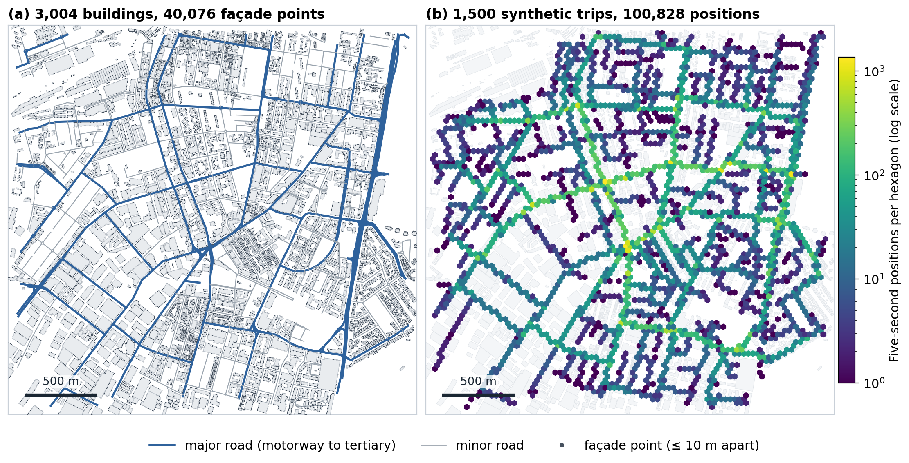
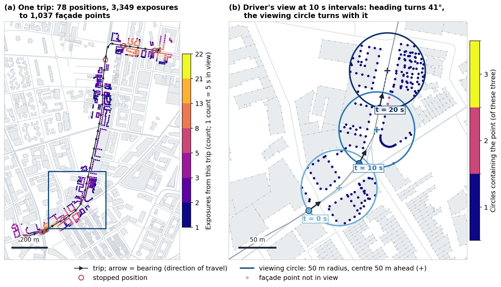
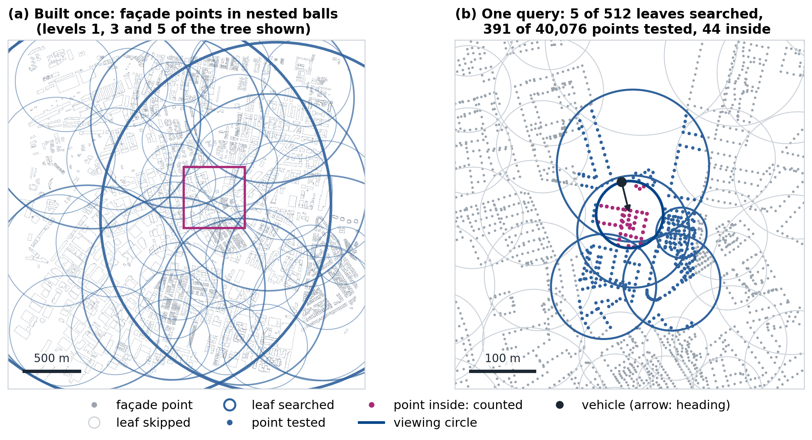
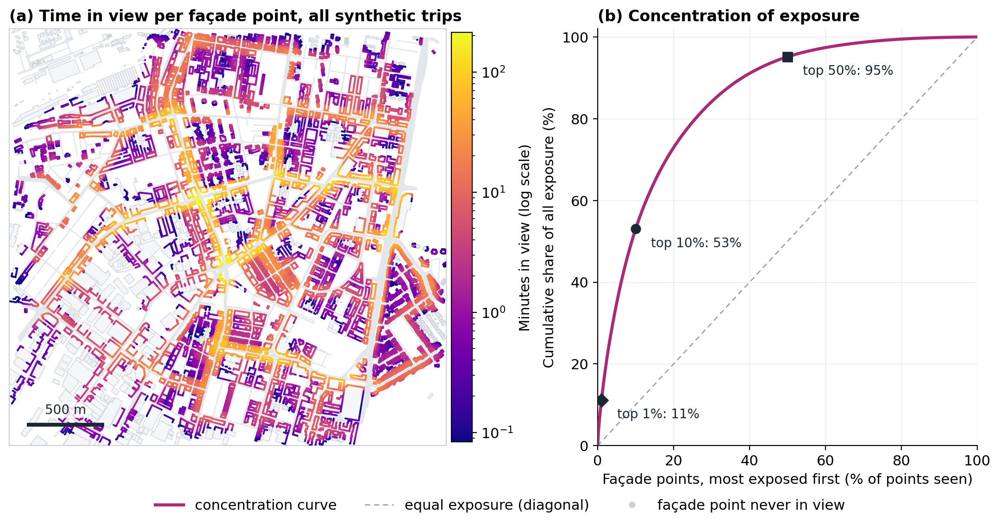
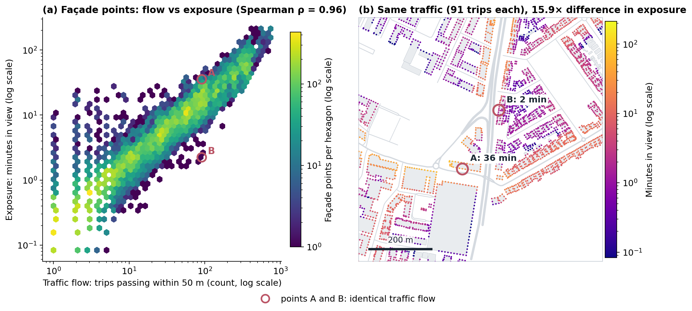
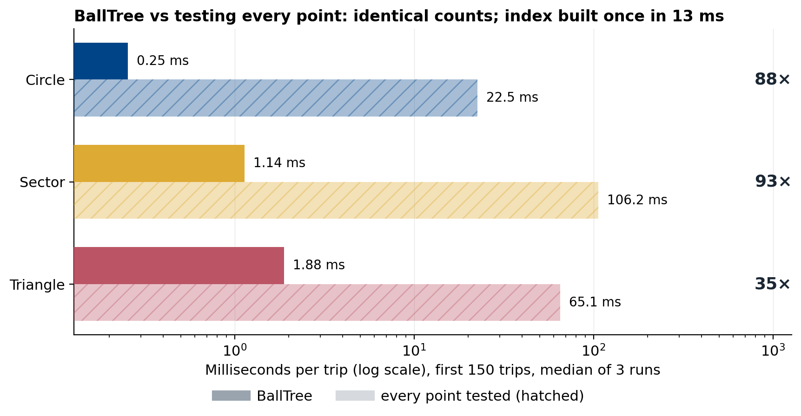
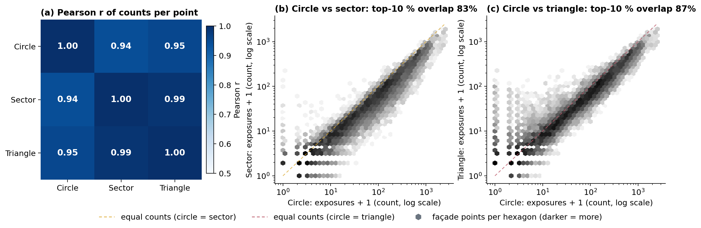

# Façade exposure from vehicle trajectories

How long is each building façade in the forward view of passing vehicles? Method:

> A. Grigorev and A.-S. Mihăiţă. *Rapid Quantification of Outdoor Object Visibility in Urban Setting Using
> Connected-Vehicle Fields of View.* SIGSPATIAL '26: 34th ACM International Conference on Advances in Geographic
> Information Systems, Riverside, CA, USA, 2026. Preprint: https://arxiv.org/abs/2506.03365

It runs end to end on the open data in `data/`: OpenStreetMap buildings and roads of Waterloo (Sydney), and **synthetic**
vehicle trips driven on that road network. The paper uses connected-vehicle data that cannot be redistributed, so the
numbers here illustrate the method and do not reproduce the paper's results.

## Method in five steps

1. **Trajectories at a fixed interval.** Every trip is a sequence of positions five seconds apart, each with the
   direction of travel (bearing). A fixed interval makes every count stand for the same length of time.
2. **Viewing area.** At each position, the forward view is approximated by a circle of 50 m radius centred 50 m ahead
   of the vehicle. It touches the vehicle, reaches 100 m ahead, and is the circle that best matches a 60° view
   (demo 01).
3. **Façade points.** Building outlines are densified so that points are at most 10 m apart; exposure is attributed
   to these points, so different parts of one wall can differ.
4. **Spatial index.** A BallTree over the façade points answers "which points are inside this circle?" without
   testing every point (demo 04). The result is identical to an exhaustive test (demos 03, 07).
5. **Aggregation.** Each façade point gets one count per five-second position whose circle contains it:
   **one count = 5 s in view**.

```python
from visibility_demo import exposure
from visibility_demo.data import load_scene

scene = load_scene()                           # buildings, façade points, trips, roads
counts = exposure.count_balltree(scene.tree, scene.points, *scene.xyb, shape="circle")
minutes_in_view = counts * 5 / 60              # one count = 5 s in view
```

## Quick start

```bash
python -m pip install -r requirements.txt
python demos/run_all.py            # runs demos 01-08 (about two minutes; demo 07 is the slow one)
```

Each demo is a standalone script that writes one figure to `figures/`; the docstring at the top of each script states
what the figure shows and which relation the script checks before drawing it. `demos/00_make_synthetic_trips.py`
regenerates the trip file (already included).

## Demo figures

| Demo | Figure | What it shows |
|---|---|---|
| 01 |  | The three viewing shapes (circle, sector, triangle) and the Dice similarity of circles tangent at the vehicle with the 60° sector: the circle reaching 100 m ahead fits best (0.73). |
| 02 |  | Inputs: 3,004 OSM buildings, about 40,000 façade points, the road network, and 100,828 five-second positions of 1,500 synthetic trips, concentrated on the major roads. |
| 03 |  | One trip: the bearing at every 5-s position and the counts each façade point receives (stops at junctions add counts to the same façades); zoom: the driver's viewing circle, 50 m ahead along the bearing, turning with the vehicle. |
| 04 |  | How the BallTree answers one query: whole balls far from the circle are skipped; under 1 % of the façade points are tested. |
| 05 |  | Minutes in view per façade point over all trips, and the concentration curve: the top 10 % of points receive about half of all exposure. |
| 06 |  | Exposure vs traffic flow: correlated, but two points passed by the same number of trips can differ many times in time in view. |
| 07 |  | BallTree vs exhaustive testing for the three shapes: identical counts, tens of times faster, circle fastest. |
| 08 |  | The three shapes produce strongly correlated counts and largely the same top-10 % façades. |

Values quoted above come from the included synthetic data; timings in demo 07 depend on the machine.

## Repository layout

```
visibility_demo/      the method as a small package
    geo.py            local metric projection, bearings
    buildings.py      building outlines -> densified façade points
    shapes.py         circle / sector / triangle and vectorised point-in-shape tests
    exposure.py       BallTree index, exposure counting, exhaustive baseline, traffic flow
    synthetic.py      synthetic trips on the road network
    data.py           loaders for data/ (load_scene: all inputs at once)
    plotting.py       shared figure style
demos/                00-08, one script per figure; run_all.py; _path.py (import helper)
data/                 buildings and roads (OpenStreetMap), synthetic trips
figures/              figures written by the demos
outputs/              tables written by the demos (exposure per façade point, benchmark)
```

## Data and licences

| File | Content | Source and licence |
|---|---|---|
| `data/buildings_waterloo.geojson` | 3,004 building outlines | © OpenStreetMap contributors, [ODbL](https://opendatacommons.org/licenses/odbl/) |
| `data/roads_waterloo.geojson` | drivable road centre lines with OSM `highway` class | © OpenStreetMap contributors, ODbL |
| `data/trips_synthetic.csv.gz` | 1,500 synthetic trips, one row per five-second position: `trip_id, timestamp, lat, lon, bearing, speed_mps` | generated by `demos/00_make_synthetic_trips.py`; contains no real vehicle data |

The code is released under the MIT licence (`LICENSE`). Data derived from OpenStreetMap remain under the ODbL
(`data/LICENSE-DATA.md`).

## Simplifications compared with the paper

- Trips are synthetic: routes are fastest paths on an undirected road graph (one-way streets ignored), with random
  speeds and random stops at junctions of major roads.
- The viewing model is two-dimensional: buildings do not block each other's view.

## Citation

```bibtex
@inproceedings{grigorev2026visibility,
  author    = {Grigorev, Artur and Mih{\u{a}}i{\c{t}}{\u{a}}, Adriana-Simona},
  title     = {Rapid Quantification of Outdoor Object Visibility in Urban Setting Using Connected-Vehicle Fields of View},
  booktitle = {Proceedings of the 34th ACM International Conference on Advances in Geographic Information Systems
               (SIGSPATIAL '26)},
  year      = {2026},
  address   = {Riverside, CA, USA},
  publisher = {ACM},
  url       = {https://arxiv.org/abs/2506.03365}
}
```
